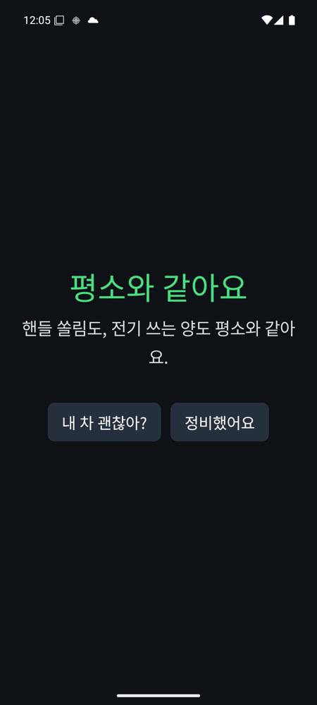
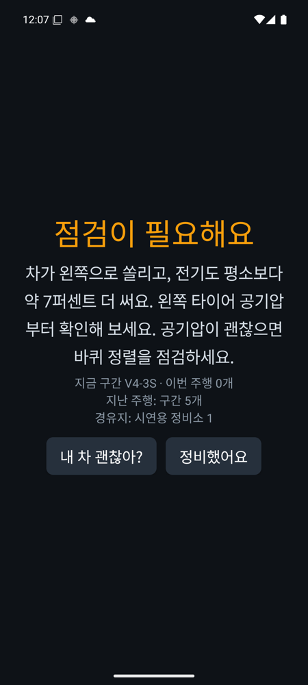
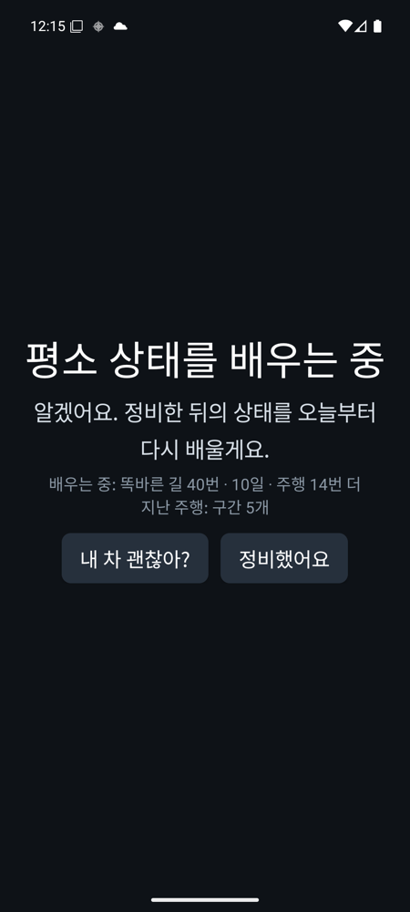

# 플릿 닥터 (Fleet Doctor)

같은 길을 지난 다른 차들과 비교해서, **내 차의 핸들 쏠림과 에너지 소비가 평소와 달라진 것**을 정비소에 가기 전에 알려 주는 Pleos 앱입니다.

> "차가 왼쪽으로 쏠리고, 전기도 평소보다 약 7퍼센트 더 써요. 왼쪽 타이어 공기압부터 확인해 보세요."
> → "가까운 정비소를 경유지로 넣을까요?" → "응" → 경유지 추가

| 평소 | 이상을 찾았을 때 | "정비했어요" 뒤 |
| --- | --- | --- |
|  |  |  |

## 심사용 요약

| 항목 | 내용 |
| --- | --- |
| 앱 이름 · 한 줄 소개 | 플릿 닥터 — 같은 길을 지난 다른 차들과 비교해 핸들 쏠림·에너지 소비 변화를 정비소에 가기 전에 음성으로 알리고, 가까운 정비소를 경유지로 넣어 주는 Pleos 앱 |
| APK 위치 | [`apk/TEAMNAME_FleetDoctor_release.apk`](apk/) — 시연용(mock) release 빌드, 일반 안드로이드 에뮬레이터에서 실행<br>[`apk/TEAMNAME_FleetDoctor-pleos_release.apk`](apk/) — 실차용(pleos) release 빌드, Pleos Connect SDK 5종 사용(Pleos Connect 환경 필요) |
| 테스트 환경 | macOS, Android Emulator(Android 16 · API 36, arm64), Python 3.11 이상, JDK 17 이상, Gradle 8.10 · AGP 8.7 · Kotlin 2.0 |
| 필요한 설정 | 시연용 앱은 같은 컴퓨터에서 도는 플릿 닥터 서버(`http://10.0.2.2:8000`, 에뮬레이터에서 본 내 컴퓨터)와 시연 운전 스크립트가 있어야 움직입니다. 아래 [실행 방법](#실행-방법)을 따르세요. 앱 권한: 위치, 알림 |
| 시연 영상 | 접수 메일에 첨부한 `fleetdoctor_demo.mp4` (2분 20초, 에뮬레이터 화면 녹화) |

## 왜 어려운가, 어떻게 푸는가

핸들 각도와 에너지 소비는 고장보다 **길과 날씨**에 더 크게 흔들립니다. 길이 바깥쪽으로 기울어 있으면 똑바로 가려고 핸들을 조금 돌리고, 오르막·맞바람·추위면 에너지를 더 씁니다. 내 차 기록만 보면 이 흔들림을 고장으로 착각합니다.

1. **차마다 자기 평소 값을 배웁니다.** 처음 10일 이상, 똑바른 구간 40번 이상, 주행 14번 이상으로 평소 핸들 각도·에너지와 흔들림을 잡습니다. 차종·센서 0점·운전 습관 차이는 모두 이 평소 값에 들어갑니다.
2. **길 몫은 다른 차들에게서 얻습니다.** 차는 구간마다 "평소보다 얼마나 달랐나"(편차)만 차 ID 없이 서버에 보냅니다. 서버는 이것을 모아 구간·날짜마다 길과 날씨가 주는 몫을 **차종마다 따로** 계산합니다.
3. **차종 차이는 환산 비율로 메웁니다.** 같은 길이라도 대형 SUV는 핸들 반응이 크고, 전기차는 추위에 에너지를 훨씬 더 씁니다. 서버는 보고만으로 차종 사이의 비율을 찾아, 같은 차종 보고가 적은 구간은 다른 차종 값을 비율로 바꿔 씁니다.
4. **꾸준한 변화만 알립니다.** 차는 내 값에서 길 몫과 평소 값을 뺀 '내 차 몫'을 주행 단위 누적 점수(CUSUM)로 쌓습니다. 점수가 문턱을 넘고, 최근 4번 주행 평균도 기준의 70%를 넘고, 그중 2번 이상이 같은 쪽일 때만 알립니다. 차로 변경이 섞인 주행 한 번으로는 알리지 않습니다.
5. **무엇이 의심되는지 말합니다.** 쏠림만 있으면 공기압 → 바퀴 정렬, 쏠림과 에너지가 함께 늘면 그쪽 타이어 공기압, 에너지만 늘면 브레이크 끌림·공기압 점검을 권합니다.

자세한 계산은 [docs/algorithm.md](docs/algorithm.md), 차와 서버가 주고받는 형식은 [docs/protocol.md](docs/protocol.md)에 있습니다.

## 시뮬레이션 결과

차종 6가지(전기 4, 내연·하이브리드 2)가 섞인 차 600대가 70일 동안 가상의 바둑판 도로(80구간)에서 출퇴근하고, 그중 51대에 고장을 넣었습니다. 길 몫을 구하는 방식만 바꿔서 비교했습니다([simulator/results/compare.json](simulator/results/compare.json)).

| 길 몫을 구하는 방식 | 찾은 고장 | 알림 중 진짜 고장 | 오경보 (1,000대·일당) |
| --- | --- | --- | --- |
| 내 차 평소 값만 봄 | 13/51 | 2% | 17.9 |
| 다른 차와 비교, 차종 무시 | 38/51 | 9% | 12.7 (전기차 18.1, 내연 0.5) |
| **다른 차와 비교, 차종 반영 (플릿 닥터)** | **49/51** | **68%** | **0.76** |
| 실제 길 몫을 그대로 안다고 칠 때 (참고) | 49/51 | 53% | 1.45 |

- **고장마다:** 바퀴 정렬 18/18(중앙값 당일), 타이어 바람 빠짐 16/18(중앙값 8.5일, 시뮬레이터의 타이어 경고등보다 중앙값 2일 먼저), 브레이크 끌림 15/15(중앙값 3일). 찾은 49건 중 47건은 권한 점검이 맞았습니다.
- **오경보:** 1,000대·일당 0.76건은 차 한 대 기준으로 3~4년에 한 번꼴입니다.
- **차 수가 적을 때:** 150대에서는 15/15, 오경보 0.41이었습니다. 60대(차종당 10대)로 줄이면 오경보가 5.9로 늘어서, 출시 초기에는 더 보수적으로 알려야 합니다.
- **주의:** 실제 차 데이터가 아니라 그럴듯하게 정한 가정(길 기울기, 날씨, 차종 반응, 고장 크기, 운전 잡음)으로 만든 숫자입니다.

## 에뮬레이터 시연 (mock 빌드)

시연 차가 30일 동안 탄 기록을 받아 평소 값을 배운 상태에서 출발합니다. 출근·퇴근은 평소처럼 하고, 세 번째 주행부터 왼쪽 앞 타이어 바람이 빠지게 했습니다(핸들 +1.8도, 에너지 +6%). 실제 기록은 [docs/images/e2e_drive_log.txt](docs/images/e2e_drive_log.txt)에 있습니다.

```
주행 1·2  고장 없음 → "핸들 쏠림도, 전기 쓰는 양도 평소와 같아요."
주행 3    고장 시작 → 아직 알리지 않음(한 번으로는 부족)
주행 4    (같은 날 퇴근) → "차가 왼쪽으로 쏠리고, 전기도 평소보다 약 4퍼센트 더 써요. 왼쪽 타이어 공기압부터…"
          "가까운 정비소를 경유지로 넣을까요?" → "응" → "시연용 정비소 1, 경유지로 넣었어요."
주행 5·6  고장 계속 → 알림 유지(같은 말을 되풀이하지 않음), 이 차의 익명 보고는 멈춤
```

처음 알림의 4%는 최근 4번 주행에 평소 주행 2번이 섞여 작게 나온 값이고, 다음 주행에서 7%로 바로잡힙니다. 시연 시계는 실제보다 25배 빨리 가서, 7.5km 출근·퇴근 6번(약 45km)이 약 2분 40초 걸립니다.

## 실행 방법

필요한 것: Python 3.11 이상, Android SDK(에뮬레이터), JDK 17 이상(Android Studio에 들어 있는 것).

```bash
python3 -m venv .venv
```

```bash
.venv/bin/pip install -r server/requirements.txt
```

**서버와 관제 화면** (http://localhost:8000)

```bash
.venv/bin/python -m uvicorn fleetdoc.app:app --app-dir server --port 8000
```

**서버 채우기**: 차 600대의 지난 30일 익명 보고와, 시연 차의 지난 기록을 올립니다(서버를 켤 때마다).

```bash
.venv/bin/python simulator/sim.py --server http://127.0.0.1:8000
```

**앱 빌드** (android 폴더에서, 직접 빌드할 때만): `mock`은 일반 에뮬레이터용, `pleos`는 Pleos Connect SDK를 쓰는 실차용입니다. SDK는 Pleos Playground 공개 저장소에서 받습니다. release 빌드는 `android/keystore.properties`의 서명 키가 있을 때만 서명됩니다(저장소에는 없음).

```bash
./gradlew testMockDebugUnitTest assembleMockDebug assemblePleosDebug
```

**에뮬레이터 시연**: 앱을 설치하고 위치·알림 권한을 준 뒤 켭니다. 앱이 서버에서 시연 차의 지난 기록을 받아 평소 상태를 배운 채로 시작합니다. 그다음 시연 운전을 돌립니다.

```bash
adb -s emulator-5554 install -r apk/TEAMNAME_FleetDoctor_release.apk
```

```bash
adb -s emulator-5554 shell pm grant com.fleetdoctor android.permission.ACCESS_FINE_LOCATION
```

```bash
adb -s emulator-5554 shell am start -n com.fleetdoctor/.ui.MainActivity
```

```bash
.venv/bin/python simulator/drive_emulator.py --server http://127.0.0.1:8000 --serial emulator-5554
```

`--fault`로 고장 종류(`tire`, `alignment`, `drag`)를 바꿀 수 있습니다. 앱 화면의 "정비했어요"를 누르면 평소 값을 처음부터 다시 배웁니다.

**시뮬레이션 비교 다시 돌리기** (몇 분 걸립니다)

```bash
.venv/bin/python simulator/sim.py --cars 600 --days 70
```

**시험**: 서버 29개, 앱 15개. 앱의 판단 로직은 서버 쪽 기준 구현과 같은 시험 자료([server/tests/vectors/carhealth.json](server/tests/vectors/carhealth.json))를 69단계 다시 돌려, 매 단계 소수점 12자리까지 같은지 봅니다.

```bash
.venv/bin/python -m pytest server/tests -q
```

## Pleos SDK를 쓰는 곳 (pleos 빌드)

| SDK | 쓰는 곳 | 권한 |
| --- | --- | --- |
| Vehicle 2.3.2 | 핸들(앞바퀴) 각도 `SteeringWheel.registerSteeringWheelAngle`, 순간 전비 `EvBattery.registerInstantaneousEvEfficiency`(km/kWh), 순간 연비 `Fuel.registerInstantaneousFuelEconomy`(L/100km) | `CAR_DRIVE`, `CAR_ENERGY` |
| FusedLocation 1.1.3 | 차량 센서와 합친 위치·진행 방향 → 구간 맞추기 | 위치 |
| TextToSpeech 3.3.1 | 알림·대답을 소리로 | |
| SpeechToText 3.3.1 | "경유지로 넣을까요?"에 대한 대답 듣기 | |
| NaviHelper 3.0.5 | 가까운 정비소를 경유지로 `addWaypoint` | |

- **차이 1:** SDK의 조향각은 핸들 각도가 아니라 앞바퀴 각도라서, 기준 조향비 15를 곱해 쓰고 알림에는 "약 2도"처럼 '약'을 붙입니다. 차종마다 다른 조향비는 평소 값과 서버의 환산 비율이 흡수합니다.
- **차이 2:** 타이어 경고등(TPMS)은 일반 앱이 읽을 수 없는 권한(`PRIVATE_CAR_SAFETY`)이라 쓰지 않습니다. 대신 사용자가 "정비했어요"라고 알려 주면 평소 값을 다시 배웁니다.
- **확인 범위:** pleos 빌드는 실제 SDK로 컴파일까지만 확인했고, Pleos Connect 기기·에뮬레이터에서 돌려 보지는 못했습니다.

## 개인정보

- **서버로 가는 것:** 차종 묶음(A~F), 날짜, 구간 ID와 구간별 편차뿐입니다. 차 ID·주행 ID·시각·좌표는 보내지 않습니다.
- **차 안에만 있는 것:** 평소 값, 주행 기록, 고장 판단. 서버는 어느 차가 고장인지 모릅니다.
- **고장 의심 차의 보고:** 보내지 않습니다. 고장 난 차가 다른 차들의 길 몫을 흐리지 않게 하려는 것입니다.
- **서버가 아는 위치:** 구간 목록을 받을 때 대략 어느 칸(약 5km)에 있는지만 압니다.

## 한계와 다음 할 일

- **실제 데이터로 맞추기:** 길·날씨·차종 반응·고장 크기는 가정입니다. 실제 차 기록으로 문턱과 학습량을 다시 맞춰야 합니다.
- **차종 묶음 고르기:** 지금은 앱 설정값입니다. VIN으로 자동으로 고르려면 차종 코드표와 권한 협의가 필요해 아직 하지 않았습니다.
- **정비소 목록:** 시연 지도의 정비소는 가상의 곳입니다. 실제 블루핸즈 목록과 붙여야 합니다.
- **굽은 길:** 핸들 각도는 똑바른 구간에서만 씁니다(시연 지도 80구간 중 58개). 구간 양 끝 150m는 교차로에서 줄이고 도는 곳이라 값에 넣지 않습니다.
- **출시 초기:** 차가 적은 동안에는 오경보가 늘어나므로 문턱을 높게 잡아야 합니다.

## 폴더 구성

```
server/       FastAPI 서버(fleetdoc/), 관제 화면(static/), 시험(tests/)
  fleetdoc/carmodel.py   차 안 판단의 기준 구현 (앱이 같은 계산을 한다)
  fleetdoc/effects.py    차종별 길 몫 추정 (Huber 평균, 차종 환산, 수축)
simulator/    세계·차·고장 시뮬레이터(fleet.py), 방식 비교(sim.py), 시험 자료(make_vectors.py), 에뮬레이터 운전(drive_emulator.py)
android/      앱. main/(판단·구간·서버·화면), mock/(시연 연결), pleos/(Pleos SDK 연결)
docs/         알고리즘, 메시지 형식, 시연 화면
```
